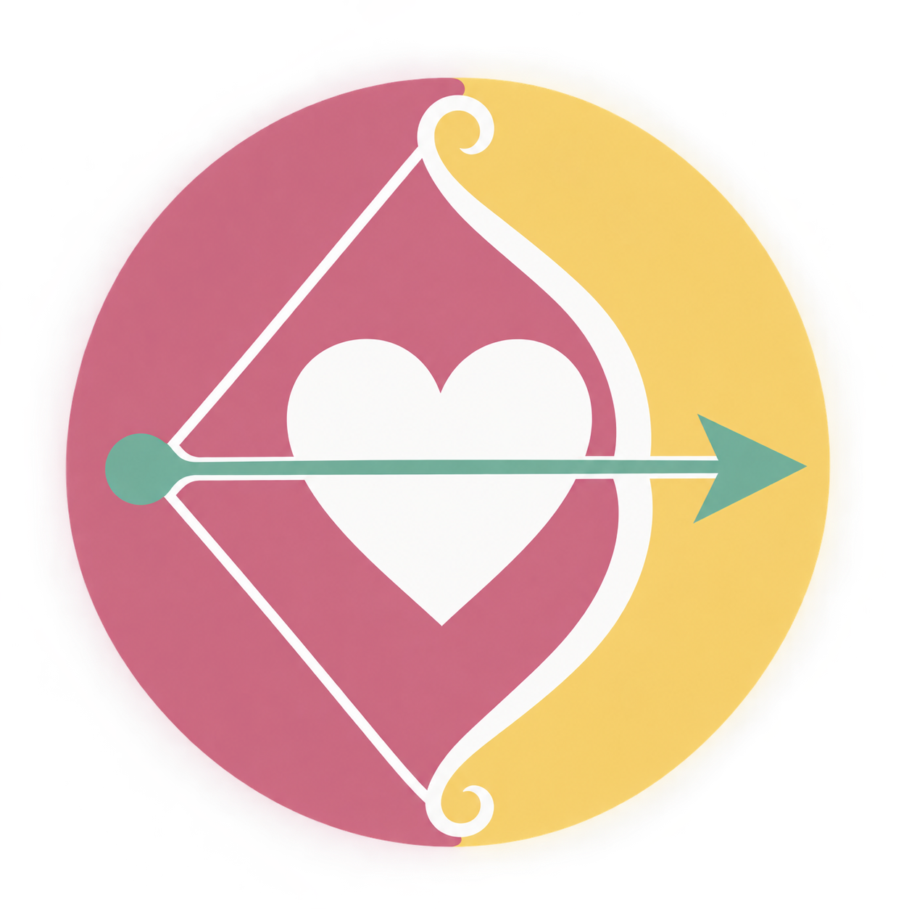
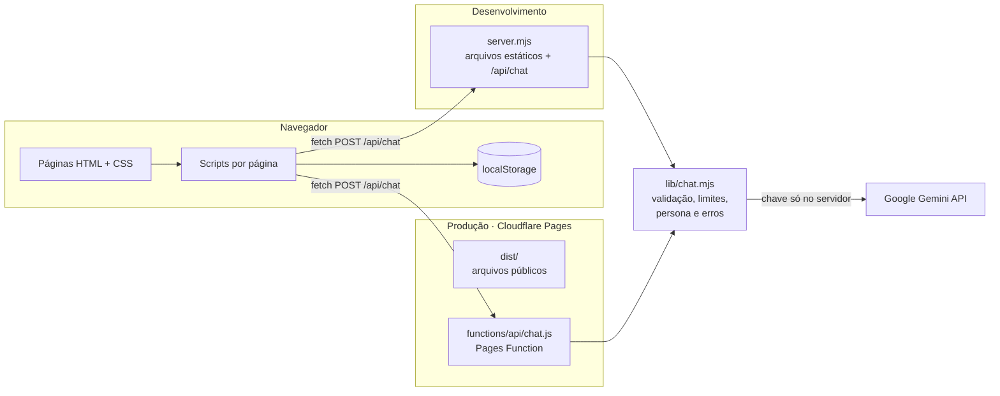

<div align="center">



# Love Journey

**Uma jornada para se conhecer, se entender e construir relações mais saudáveis.**

Aplicação web de autoconhecimento, comunicação e educação sobre relacionamentos para jovens e adolescentes, com diário a dois, check-in emocional, desafios de casal, rede de apoio profissional e um Diário com IA (Google Gemini).

[](https://front-end-4cu.pages.dev/boas-vindas)


**[Ver online](https://front-end-4cu.pages.dev/boas-vindas)** · [Funcionalidades](#funcionalidades) · [Arquitetura](#arquitetura) · [Como rodar](#como-rodar-localmente) · [Equipe](#equipe)

</div>

---

## Sumário

- [Sobre o projeto](#sobre-o-projeto)
- [Destaques técnicos](#destaques-técnicos)
- [Experimente agora](#experimente-agora)
- [Funcionalidades](#funcionalidades)
- [Arquitetura](#arquitetura)
- [Diário com IA](#diário-com-ia-google-gemini)
- [Dados no navegador](#dados-no-navegador)
- [Segurança e privacidade](#segurança-e-privacidade)
- [Acessibilidade e responsividade](#acessibilidade-e-responsividade)
- [Qualidade e CI](#qualidade-e-ci)
- [Estrutura de pastas](#estrutura-de-pastas)
- [Como rodar localmente](#como-rodar-localmente)
- [Deploy](#deploy-cloudflare-pages)
- [Aplicativo Android](#aplicativo-android)
- [Decisões técnicas](#decisões-técnicas)
- [Roadmap](#roadmap)
- [Equipe](#equipe)
- [Licença](#licença)

---

## Sobre o projeto

Muitos jovens vivem os primeiros relacionamentos sem um espaço seguro para entender o que sentem, conversar sobre limites ou saber onde pedir ajuda. O **Love Journey** foi criado para ser esse espaço: acolhedor, sem julgamento e com linguagem próxima do público.

A aplicação tem duas áreas:

| Área | Para quem | O que oferece |
|---|---|---|
| **Casal** | Jovens em um relacionamento | Painel do casal, diários com fotos, check-in emocional, desafios de comunicação, Diário com IA e caminhos de apoio |
| **Profissional** | Psicólogos e mentores | Perfil profissional, conversas com os casais atendidos e uma comunidade entre profissionais |

O projeto segue alguns princípios que guiaram cada decisão de produto e de código:

> pessoas antes da tecnologia · experiência antes da complexidade · clareza antes de excesso de funcionalidades · acolhimento antes de julgamento · consistência antes de mudanças desnecessárias

---

## Destaques técnicos

- **Zero framework, zero dependência.** 16 páginas em HTML, CSS e JavaScript puros, sem bundler e sem `package.json`. O servidor local é um único arquivo Node que usa só módulos nativos.
- **Integração com IA generativa de forma segura.** O Diário com IA conversa com o Google Gemini por um proxy no servidor. A chave da API nunca chega ao navegador, e um verificador automático impede que ela seja publicada por engano.
- **Uma lógica, dois ambientes.** O mesmo módulo (`lib/chat.mjs`) atende o servidor Node local e a Cloudflare Pages Function de produção, sem duplicar regras de validação, limites ou mensagens de erro.
- **Persistência local.** Diários, emoções, desafios, contatos, publicações e conversas com a IA ficam salvos no `localStorage` e continuam lá depois de recarregar a página.
- **Proxy endurecido.** Limite de 15 requisições por minuto por IP, corpo de no máximo 24 KB, histórico de até 12 mensagens, timeout de 45 s, bloqueio de *path traversal* e de arquivos ocultos (`.env`, `.git`) e cabeçalhos `nosniff` e `Referrer-Policy`.
- **CI no GitHub Actions.** A cada push e pull request: checagem de sintaxe de todos os scripts, verificação de links, imagens e redirecionamentos entre páginas, busca de chaves de API no front-end e build de produção.
- **Build mínimo para produção.** Um script gera `dist/` só com os arquivos públicos. Código de servidor, documentação e segredos ficam fora do deploy.
- **Design system em tokens.** Cores e fontes centralizadas em variáveis CSS em `css/base.css`, com regras compartilhadas da sidebar em `css/sidebar.css`.
- **Conteúdo responsável.** A IA tem uma persona definida que não se apresenta como psicóloga, prioriza segurança em relatos de violência ou risco e não pede dados pessoais. A página de Apoio lista canais gratuitos 24h (CVV 188, Ligue 180, Disque 100, SAMU 192, Polícia 190).

---

## Experimente agora

**https://front-end-4cu.pages.dev/boas-vindas**

A versão publicada vem com dados de exemplo (o casal Ana e Lucas e o profissional Gabriel Queiroz) para mostrar o produto em uso. Roteiro sugerido:

1. Em **Boas-vindas**, escolha **Sou Cliente** e entre com qualquer e-mail e senha válidos. O login é uma simulação; nenhuma conta real é criada.
2. No painel do casal, registre como você está se sentindo, escreva no diário, avance em um desafio e converse com o **Diário com IA**.
3. Em **Apoio**, veja os mentores, os conteúdos e os canais de ajuda.
4. Volte para **Boas-vindas**, escolha **Sou Profissional** e entre de novo para conhecer o painel, as conversas com os usuários e a comunidade.

> O que você registra fica salvo só no seu navegador. Para voltar aos dados originais, limpe os dados do site em DevTools → Application → Clear site data.

---

## Funcionalidades

### Acesso

- Landing page com a proposta, jornada em 5 passos, depoimentos e planos.
- Escolha de perfil (cliente ou profissional), cadastro com validação de campos e modal de política de privacidade.
- Cadastro em duas etapas para profissionais (dados pessoais e dados profissionais).
- Login com validação, opção de lembrar o e-mail e redirecionamento para o painel do perfil escolhido.
- Fluxo de recuperação de senha.

### Área do casal

| Página | O que dá para fazer |
|---|---|
| **Início** (`dashboard-casal.html`) | Humor do dia de cada pessoa, resumo da semana e conexão com o profissional que acompanha o casal |
| **Diários** (`diario-do-casal.html`) | Registros com texto, categoria e fotos (comprimidas no navegador antes de salvar), filtros, calendário e detalhe de cada registro |
| **Diário com IA** (`diario-com-ia.html`) | Conversa acolhedora com o Gemini para refletir sobre sentimentos, com histórico de sessões e nova conversa a qualquer momento |
| **Minhas emoções** (`dashboard-emocoes.html`) | Check-in emocional, histórico paginado, gatilhos e insights da semana |
| **Desafios** (`desafios-do-casal.html`) | Desafios por categoria, progresso por etapas, sugestões, criação de desafios próprios com prazo e meta e resumo do que já foi concluído |
| **Apoio** (`apoio.html`) | Mentores, agendamento de conversa, contatos de confiança, conteúdos educativos e canais oficiais de ajuda |

### Área do profissional

| Página | O que dá para fazer |
|---|---|
| **Início** (`dashboard-profissional.html`) | Perfil profissional editável, com especialidades |
| **Usuários** (`usuarios-do-profissional.html`) | Lista de casais atendidos, filtros, busca, solicitações e chat |
| **Comunidade** (`comunidade.html`) | Feed entre profissionais com publicações, anexos de imagem e vídeo, curtidas, comentários e filtros |

Todas as telas dão retorno ao usuário: mensagens de erro em linguagem simples, estados de carregamento e status anunciados para leitores de tela.

---

## Arquitetura



**Como as peças se encaixam**

- **Front-end:** cada página tem seu próprio HTML, CSS e JS com o mesmo nome. Os scripts não usam módulos; são IIFEs ou rodam no `DOMContentLoaded`, com `querySelector` e `<dialog>` nativo para modais.
- **`lib/chat.mjs`:** concentra a regra de negócio do chat (validação do histórico, limites, persona da IA, chamada ao Gemini e tradução dos erros para português).
- **`server.mjs`:** servidor HTTP com módulos nativos do Node. Serve os arquivos estáticos e expõe `/api/chat` em desenvolvimento.
- **`functions/api/chat.js`:** a mesma rota em produção, como Cloudflare Pages Function, lendo a chave dos *secrets* do projeto.

---

## Diário com IA (Google Gemini)

O Diário com IA ajuda a pessoa a nomear sentimentos e entender situações do relacionamento. É apoio à reflexão, nunca diagnóstico, e a interface deixa isso claro.

**Contrato da API**

```http
POST /api/chat
Content-Type: application/json

{ "messages": [ { "role": "user", "text": "Hoje fiquei chateada com..." } ] }
```

```json
{ "reply": "Faz sentido você ter ficado assim. Quer me contar o que aconteceu?" }
```

Em caso de erro, a resposta traz `{ "error": "..." }` com uma mensagem em português pronta para mostrar na tela.

**Limites e tratamento de erros**

| Regra | Valor |
|---|---|
| Modelo | `gemini-3.8-flash` |
| Histórico por requisição | até 12 mensagens |
| Tamanho de cada mensagem | até 2.000 caracteres |
| Tamanho do corpo | até 24 KB |
| Requisições por IP | 15 por minuto |
| Timeout da chamada ao Gemini | 45 s |
| Tokens de saída | até 1.200 |

O módulo normaliza o histórico (remove mensagens iniciais da IA, junta mensagens seguidas do mesmo autor e exige que a última seja do usuário) e mapeia cada falha para uma resposta clara: chave ausente (503), cota esgotada (429), credencial inválida (503), resposta vazia ou cortada (502) e demora (504).

**Persona**

A instrução de sistema define uma companhia acolhedora, em português, que não julga nem toma partido sem contexto, faz perguntas abertas, sugere caminhos práticos para comunicação, limites e autocuidado, **não se apresenta como psicóloga nem substitui apoio profissional**, prioriza a segurança em relatos de violência, coerção ou risco e não pede dados pessoais.

---

## Dados no navegador

O projeto não usa backend nem banco de dados, por decisão da equipe. Cada funcionalidade guarda o próprio estado no `localStorage`, lido com tratamento de erro para o caso de dados ausentes ou corrompidos.

| Chave | Conteúdo |
|---|---|
| `perfilEscolhido` | Perfil escolhido em Boas-vindas (cliente ou profissional) |
| `emailLoveJourney` | E-mail lembrado no login |
| `loveJourney.dashboardCasal` | Humor do dia e estado do painel do casal |
| `love-journey-diary-entries` | Registros do diário do casal |
| `love-journey-emocoes`, `loveJourney.dashboardEmotions` | Check-ins emocionais |
| `loveJourney.desafiosCasal` | Progresso e desafios criados |
| `loveJourney.diarioIA` | Sessões do Diário com IA |
| `loveJourney.apoio` | Contatos de confiança e agendamentos |
| `loveJourney.profissional` | Perfil do profissional |
| `loveJourney.comunidade.*` | Publicações, comentários e curtidas da comunidade |

---

## Segurança e privacidade

- **Segredos fora do front-end:** `GEMINI_API_KEY` fica no `.env` (ignorado pelo Git) ou nos *secrets* do Cloudflare. O CI falha se encontrar uma chave em HTML ou JS.
- **Proteção contra XSS:** o conteúdo escrito pelo usuário passa por `escapeHtml` antes de ir para o `innerHTML`.
- **Servidor local seguro por padrão:** escuta em `127.0.0.1`, recusa caminhos fora da pasta do projeto e qualquer segmento que comece com `.`, aceita só `GET`/`HEAD` nos arquivos e `POST` na API.
- **Deploy enxuto:** só páginas, `assets/`, `css/` e `js/` vão para produção. `server.mjs`, `lib/`, `docs/`, `.env` e `.git` não são publicados.
- **Transparência:** o modal de privacidade do cadastro explica que as conversas do Diário com IA são enviadas ao Gemini para gerar as respostas e que o histórico fica no navegador.

---

## Acessibilidade e responsividade

- HTML semântico (`header`, `nav`, `main`, `section`, `article`, `aside`, `footer`), `<button>` para ações e `<a>` para navegação.
- Modais com `<dialog>` nativo, que já tratam foco e tecla Esc.
- `alt` em todas as imagens, `aria-label` em botões só com ícone, ícones decorativos com `aria-hidden` e `aria-current="page"` no item ativo da sidebar.
- Mensagens de status com `aria-live`.
- Layout testado em desktop, tablet e celular (a partir de 390 px).
- Ícones do Font Awesome em vez de emojis na interface.

---

## Qualidade e CI

O workflow [`.github/workflows/verificacao.yml`](./.github/workflows/verificacao.yml) roda a cada push e pull request:

```powershell
node scripts/verificar.mjs      # sintaxe, links, imagens, redirecionamentos e chaves expostas
node scripts/build-pages.mjs    # build de produção em dist/
```

O verificador confere:

1. a sintaxe de todos os scripts do projeto (`node --check`);
2. se todo `href`, `src` e redirecionamento em JS (`location.href`) aponta para um arquivo que existe;
3. se não há chave de API em nenhum arquivo do front-end.

O backlog do projeto, com prioridades (P0, P1, P2), critérios de aceite e o status de cada item, fica em [`docs/backlog.md`](./docs/backlog.md).

---

## Estrutura de pastas

```text
Front-End/
├── index.html                    # landing page
├── boas-vindas.html              # escolha de perfil
├── login.html · cadastro.html · cadastro-profissional.html
├── recuperar-senha.html · senha-redefinida.html
├── dashboard-casal.html          # área do casal
├── diario-do-casal.html · diario-com-ia.html
├── dashboard-emocoes.html · desafios-do-casal.html · apoio.html
├── dashboard-profissional.html   # área do profissional
├── usuarios-do-profissional.html · comunidade.html
│
├── css/
│   ├── base.css                  # tokens de cor e fonte de todas as áreas
│   ├── sidebar.css               # regras comuns da sidebar
│   ├── autenticacao/             # estilos do fluxo de acesso
│   └── <página>.css              # um CSS por página
│
├── js/
│   ├── autenticacao/             # login, cadastro e recuperação de senha
│   └── <página>.js               # um script por página
│
├── assets/imgs/                  # imagens organizadas por área e autor
├── lib/chat.mjs                  # lógica do Diário com IA (compartilhada)
├── functions/api/chat.js         # Cloudflare Pages Function (/api/chat)
├── server.mjs                    # servidor local + proxy da IA
├── scripts/
│   ├── build-pages.mjs           # gera dist/ para o deploy
│   └── verificar.mjs             # verificações do CI
├── docs/backlog.md               # backlog priorizado
└── .github/workflows/            # GitHub Actions
```

---

## Como rodar localmente

**Pré-requisito:** Node.js 18 ou mais recente. Não há nada para instalar.

```powershell
git clone https://github.com/Love-Journey-OFC/Front-End.git
cd Front-End
copy .env.example .env    # no Linux/macOS: cp .env.example .env
```

Abra o `.env` e preencha a chave do Gemini (gere uma gratuitamente no [Google AI Studio](https://aistudio.google.com/apikey)):

```env
GEMINI_API_KEY=sua-chave-aqui
```

Inicie o servidor:

```powershell
node server.mjs
```

Acesse **http://127.0.0.1:4173**. As variáveis `HOST` e `PORT` também podem ser definidas no ambiente.

> As páginas abrem direto pelo arquivo ou em qualquer servidor estático. Só o Diário com IA precisa do `server.mjs`, que expõe o `/api/chat`.

**Branches**

| Branch | Conteúdo |
|---|---|
| `main` | Versão publicada, com dados de exemplo para demonstração |
| `site-zerado` | Versão sem dados prévios, com contas de verdade no navegador (cadastro, login com senha em hash, dados separados por conta e pedidos de conversa entre casais e profissionais) |

---

## Deploy (Cloudflare Pages)

O projeto publicado em **https://front-end-4cu.pages.dev/boas-vindas** usa esta configuração no painel do Cloudflare Pages:

| Configuração | Valor |
|---|---|
| Branch de produção | `main` |
| Build command | `node scripts/build-pages.mjs` |
| Build output directory | `dist` |
| Secret (Settings → Variables and Secrets) | `GEMINI_API_KEY`, em Production e Preview |

O build copia só os `.html` da raiz, `assets/`, `css/` e `js/` para `dist/`. A pasta `functions/` é detectada automaticamente pelo Pages e vira o endpoint `/api/chat`. Uma página nova na raiz entra no build sem nenhuma configuração extra.

---

## Aplicativo Android

O app Android fica no repositório **[Love-Journey-OFC/Mobile](https://github.com/Love-Journey-OFC/Mobile)**. Ele empacota este mesmo front-end com [Capacitor](https://capacitorjs.com), a partir do `dist/` gerado aqui, sem duplicar páginas, CSS ou JS. Clone os dois repositórios lado a lado (`GitHub/Front-End` e `GitHub/Mobile`); as instruções para gerar APK e AAB estão no README do Mobile.

No app, o Diário com IA chama a API de produção (`https://front-end-4cu.pages.dev/api/chat`); a chave do Gemini continua só no Cloudflare.

---

## Decisões técnicas

| Decisão | Por quê |
|---|---|
| **HTML, CSS e JS puros** | Equipe com níveis diferentes de experiência, foco em fundamentos da web, carregamento rápido e nenhuma etapa de build para desenvolver |
| **`localStorage` em vez de banco** | Escopo de front-end definido pela equipe, sem custo de infraestrutura e com o produto funcionando por completo no navegador |
| **Proxy para a IA** | Única forma segura de usar a API do Gemini sem expor a chave no navegador |
| **`lib/chat.mjs` compartilhado** | Uma única fonte de verdade para validação, limites e erros, tanto no Node quanto no runtime do Cloudflare |
| **Cloudflare Pages + Functions** | Hospedagem estática gratuita, CDN global e função serverless na mesma plataforma, sem servidor para manter |
| **Tokens em `css/base.css`** | Mudar uma cor em um só lugar, mantendo a identidade de cada área (landing, acesso e páginas internas) |
| **`<dialog>` nativo** | Modais acessíveis sem biblioteca externa |

---

## Roadmap

- **2027:** MVP
- **2028:** expansão de funcionalidades
- **2029:** referência em relacionamento e autoconhecimento para jovens

Próximos passos já mapeados no backlog: opção de apagar conversas do Diário com IA, revisão final da política de privacidade (LGPD e consentimento de responsáveis) e testes de ponta a ponta do roteiro principal.

---

## Equipe

| Nome | Papel |
|---|---|
| Beatriz | Product Owner & Full Stack |
| Anderson | Scrum Master & Full Stack |
| Felipe | Front-end & Full Stack |
| Cibelly | Front-end & UI Designer |
| Miguel | Front-end & Full Stack |
| Jadi | Financeiro & Full Stack |
| Esther | Front-end & Full Stack |

O projeto foi desenvolvido com Scrum, backlog priorizado e verificação automática de cada mudança pelo CI.

---

## Licença

Distribuído sob a licença MIT. Veja [`LICENSE`](./LICENSE).

<div align="center">

Feito com cuidado pela equipe **Love Journey**.

**[front-end-4cu.pages.dev/boas-vindas](https://front-end-4cu.pages.dev/boas-vindas)**

</div>
